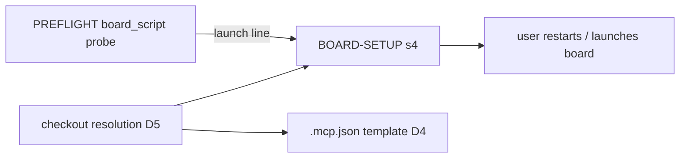

# BP-173 — Plugin BOARD-SETUP.md points at the old board path and assumes yarn

Mode: unattended lane, verification second pass over the `design-multi:resolved:v2` block (base blueprint 742c07b9, plugin ce15b09). Block checked fresh by `map-tree check` (2 owner forks, 0 open). Grounding degraded: the plugin has no CONTEXT.md and no ADR home; no context provider declared.

## Problem
BOARD-SETUP.md is wrong in three places: the board launch (`yarn blueprint:board` or the old `packages/sticky-notes-board` bin), the `.mcp.json` template path (`packages/blueprint-mcp/...`), and the checkout resolution via a `link:../blueprint` dependency no consumer has. It never says the board must be built. The same stale `packages/` layout is live in `scripts/test-design-map.sh` (criterion 5 fails against any real checkout and has been skipping, because the gate never sets BLUEPRINT_CHECKOUT) and `scripts/oracles/capture-esas-156.mjs` (stage 7 cannot resolve its imports).

Verification at this pass: the four blueprint paths the block names exist at 742c07b9 (`git -C blueprint cat-file -e`): blueprint-mcp.mjs, blueprint-board.mjs, blueprint-schema map.schema.json (under `src/packages/backend/`), bundle-config.ts. The stale-path grep (`git grep -nE 'packages/(blueprint-|sticky-notes)' -- plugins scripts ':!*LEDGER.md'`) still hits every site D8 lists; `link:../blueprint` hits BOARD-SETUP.md:27, `yarn blueprint:board` hits BOARD-SETUP.md:52 and test-blueprint-design.sh:668.

## Solution
The preflight learns how the host repo launches the board and prints the line as a tested fact. BOARD-SETUP points at blueprint's `src/` layout, resolves the checkout the way consumers do, and hands over the board-build line. Every live stale `packages/` path in the plugin is swept in the same release.

## User Stories
1. As the /design agent in kixie, I offer `pnpm run blueprint:board` with BLUEPRINT_CHECKOUT set, and it starts.
2. As the agent in a repo with no script, I offer the direct node line with the real bin path.
3. As a user registering blueprint-mcp, the template path exists.
4. As a maintainer, `BLUEPRINT_CHECKOUT=<checkout> sh scripts/test-design-map.sh` passes against a real checkout.

## Resolved decision tree

<!-- map-tree:v1 ticket=BP-173 gen=2 src=sha256:ff73d10eaf95fefc8f03586d21bbe5232c7927f6703876899bebccccb52a901d out=sha256:c5b11d77b4b33d95d0dd7ddff4c97f7897c5c0f4b1665c7aa5e31dded84ca723 -->
`map-tree:v1 ticket=BP-173 gen=2 src=sha256:ff73d10eaf95fefc8f03586d21bbe5232c7927f6703876899bebccccb52a901d out=sha256:c5b11d77b4b33d95d0dd7ddff4c97f7897c5c0f4b1665c7aa5e31dded84ca723`
### BP-173-F1 — Should the preflight work out the board launch line, or should the agent read it off the repo by following the doc?: The preflight prints a board_script verdict with the launch line

decided(owner)

Why: It turns a judgement the agent repeats on every run into a fact that is tested under two shells, which is the reason the preflight exists. It also costs one row and two fixtures.

resolved_by: human

- Rejected — The doc spells out the rule and the agent derives the line each time: no reason recorded

### BP-173-F2 — Should this ticket fix only the board-setup doc, or every place in the plugin that still points at blueprint's old packages/ layout?: Sweep every live stale path in the plugin in the same release

decided(owner)

Why: It is the same defect, in the same repo and the same release, about a dozen lines. Leaving it means a second plugin bump later for the identical fix.

resolved_by: human

- Rejected — Fix BOARD-SETUP.md only; the rest waits for a follow-up: no reason recorded
`/map-tree:v1`
<!-- /map-tree:v1 -->

## Implementation Decisions
- D1 launch line: `<pm> run blueprint:board`; pm from package.json `packageManager`, else lockfile (pnpm-lock.yaml, yarn.lock, package-lock.json), else npm. Rejected: keep yarn; list "yarn or pnpm"; always the direct node line.
- D2 when the script text contains BLUEPRINT_CHECKOUT, the launch is `BLUEPRINT_CHECKOUT=<resolved checkout> <pm> run blueprint:board`.
- D3 no script: `node <blueprint checkout>/src/apps/sticky-notes-board/bin/blueprint-board.mjs .`
- D4 template path: absolute `<checkout>/src/services/blueprint-mcp/bin/blueprint-mcp.mjs`. Rejected: relative `${CLAUDE_PROJECT_DIR}/../blueprint/...` (breaks worktrees); `${BLUEPRINT_CHECKOUT}` in .mcp.json (cannot spawn without the variable).
- D5 checkout resolution, each candidate accepted only if the blueprint-mcp bin exists under it: (1) path the repo already uses, (2) $BLUEPRINT_CHECKOUT, (3) sibling ../blueprint, (4) ask. Rejected: keep `link:`.
- D6 §4 gains: a launch exiting "no board build at …" is fixed by `yarn workspace sticky-notes-board build` in the blueprint checkout; handed to the user, never run unasked.
- D7 (F1) PREFLIGHT.md's script gains a `board_script` probe in plain shell: verdict `board_script: present|absent` plus an indented `  launch: %s` sub-line (checkout left as the placeholder `<blueprint checkout>`). Two new census rows in the decision table (test-blueprint-design.sh:600-616). BOARD-SETUP §4 says "offer the preflight's launch line". Rejected: doc-rule derivation.
- D8 (F2) sweep every live `packages/` path under plugins/** and scripts/**: design-map/SKILL.md:18, design-map.py:64, map-structure.schema.json:157 comment, test-design-map.sh:27-28,300,302,315 (to `src/packages/backend/blueprint-schema/...`; build/esm check stays conditional), the three blueprint-design fixtures' .mcp.json, design-map/select/README.md, blueprint-pending/README.md:4, capture-esas-156.mjs:12,17,43,49,50, epic-esas-156.sh:381-382. LEDGER.md untouched.
- D9 survives: restart block, never spawning the board unasked, strict :3727, `?openComments=1&author=ai`, "Do not set BLUEPRINT_REPO_PATH", PREFLIGHT matcher `*blueprint-mcp/bin/blueprint-mcp.mjs*`.
- D10 plugin version bump: not in the lane (fleet F19); the intended bump goes in the PR body, value assigned at landing.

## Testing Decisions
RED-first; each item is false or failing at ce15b09.
1. Doc seam (scripts/test-blueprint-design.sh): replace the :668 needle with asserts on "launch line" / "run blueprint:board", plus refutes on `packages/sticky-notes-board`, `packages/blueprint-mcp`, `link:../blueprint`.
2. Preflight seam, under sh, PREFLIGHT_SH=dash and bash: new fixture board-pnpm (pnpm packageManager, script reads BLUEPRINT_CHECKOUT) prints `board_script: present` and `BLUEPRINT_CHECKOUT=<blueprint checkout> pnpm run blueprint:board`; board-ready (gains `packageManager: yarn@4.15.0`) prints the yarn line; no-blueprint prints `board_script: absent` with the node line; a lockfile-only fixture (pnpm-lock.yaml, no packageManager) proves the fallback.
3. Census seam: the verdict-table test passes with both board_script rows and fails if one is missing.
4. Path existence: each blueprint path the plugin names passes `git -C <blueprint> cat-file -e 742c07b9:<path>`.
5. Sweep seam: `BLUEPRINT_CHECKOUT=<blueprint at 742c07b9, read-only detached worktree> sh scripts/test-design-map.sh` has no failing "holds the emitted map.schema.json"; the stale-path git grep returns 0.
6. Manual: `capture-esas-156.mjs` resolves its imports (stage 7 of epic-esas-156.sh); the gate never runs oracles.
7. `sh scripts/check-plugin-version-bump.sh <merge-base>` (may SKIP deferred-to-merge-multi in a lane; a SKIP is not a pass).

Tracer bullet: the riskiest uncaught thing is the preflight probe under dash (plain-shell pattern matching of package.json); the dash run of item 2 is the first slice.

## Risks
- Cache lag: no session reads the fix until the bumped version is installed.
- An absolute machine path lands in a tracked .mcp.json in shared repos (D4 alternatives break worktrees or spawn).
- BP-229/231/232 change map.schema.json and the plugin copy; criterion 5 must compare a pair at one base.
- BP-101 retires blueprint-session-server, which changes the D6 build line when it lands.

## Out of Scope
- Hosted sessions (BP-277 adds the hosted branch; its PREFLIGHT rows merge by union).
- Blueprint's own stale docs (blueprint-store README:385, sticky-notes-board README link: recipe); unfiled, nearest owner BP-101.
- PL/LEDGER.md historical paths; making the gate set BLUEPRINT_CHECKOUT.
- Unspecified seams: how a host with several package managers in a monorepo picks one (D1 reads the root package.json only); no decision here.

## Provenance
- `map-tree check --map docs/prs/BP-173/map.json --ticket BP-173 --dialect jira <units/BP-173.ticket-block.md>` -> fresh, forks=2 owner=2 open=0
- `git grep -nE 'packages/(blueprint-|sticky-notes)' -- plugins scripts ':!*LEDGER.md'`
- `git -C <blueprint> cat-file -e 742c07b9:<path>` for the four paths above
